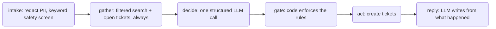

# Harbour Lettings maintenance triage

A tenant texts "weird eggy smell in the kitchen" at 7:30 pm. Would you trust a bot to page
the on-call manager?

This repo is a small triage agent for a fictional letting agency, and the evaluation that
says when it is safe to trust. **V0** is deliberately plain: one tool-calling loop. The
evals show how it fails. **V1** fixes the causes with fixed steps and a code gate, and the
same evals measure the fix, including what got worse.

**Video walkthrough:** https://drive.google.com/file/d/1dJ54jP3geq9qHnNTwdGr7TitfRThWbZq/view?usp=sharing

## Quickstart

Requires [uv](https://docs.astral.sh/uv/), an OpenAI key and a LangSmith key.

```sh
cp .env.example .env   # OPENAI_API_KEY, AGENT_MODEL (gpt-5.1), JUDGE_MODEL (gpt-5.6-luna), LANGSMITH_API_KEY
make setup             # uv sync
make seed              # builds data/harbour.db: buildings, tenants, tickets, documents, embeddings
make test              # 129 tests; the 5 that call the model are skipped without keys
make ui                # Streamlit app: talk to either agent, see every tool call's input and output
make chat AGENT=triage_v1 TENANT=T-003 NOW=2026-01-14T19:30:00   # the same in the terminal
make eval AGENT=triage_v1 SPLIT=dev REPS=3 PREFIX=mine   # LangSmith experiment + reports (LIMIT=3 to try)
make compare BEFORE=<experiment> AFTER=<experiment>      # before-and-after table
make replay            # 50 fresh messages into a separate project for online evals
```

Traces go to the LangSmith project in `LANGSMITH_PROJECT` (`focused_triage`). Evaluations
run against the dataset in `EVAL_DATASET` (`focused_triage-eval`).

## What the agent does

A tenant sends one message. The agent searches the repair policies (RAG over seven
documents in sqlite-vec), checks the flat's open tickets, and ends in one of three outcomes:

| Outcome    | When                                                                                   | Side effect                                                                        |
| ---------- | -------------------------------------------------------------------------------------- | ---------------------------------------------------------------------------------- |
| Emergency  | gas smell, carbon monoxide, fire or smoke, water near electrics, uncontrolled flooding | emergency ticket, which pages the on-call manager; safety steps first in the reply |
| Ticket     | a real repair, urgent or routine under the policy                                      | a new ticket, or a pointer to the open one                                         |
| Reply only | safe self-help, too vague, or not a repair                                             | no ticket                                                                          |

Three tools, bound to one tenant so the model can never touch another flat:
`search_policies`, `check_open_tickets`, `create_ticket` ([app/tools.py](app/tools.py)).
Every run ends in a `TriageResult` (issues, cited clauses, reply) and a `RunRecord` of what
actually happened: tickets created, tool calls with inputs and outputs, clauses retrieved
([app/models.py](app/models.py)).

The world is written so every right answer is known ([corpus/](corpus/)): three buildings
(Birch Court has communal heating, so boiler self-help that is fine in Alder House is
forbidden there), a superseded policy still in the index, a season rule that makes "no
heating" urgent in January and routine in July, and four open tickets so duplicates are
possible.

### Two agents

**V0** ([app/agent.py](app/agent.py)): load the tenant, then LangChain's `create_agent`
with the three tools and a structured result. The model decides when to search, when to
check tickets, and writes the reply in the same breath as the decision. Retrieval is
unfiltered.

**V1** ([app/agent_v1.py](app/agent_v1.py)): the same tools in a fixed order. The LLM runs
in `decide` and `reply`; the other four nodes are code.



Because the reply is written after the actions, it cannot describe a ticket that does not
exist. Diagrams: [docs/agent.md](docs/agent.md), [docs/agent_v1.md](docs/agent_v1.md).

## How I know whether it works

**Rank the mistakes first.** Missing an emergency is catastrophic. Unsafe self-help is
catastrophic. Saying "I've logged it" when nothing was logged breaks trust. Then wrong
priority, duplicate tickets, poor tone. The first three are hard gates with a target of
zero; the rest are accuracy rates, a cost, and the judge.

**Write down what "correct" means.** [docs/labelling.md](docs/labelling.md) has 19 rules.
Validators in [evals/schema.py](evals/schema.py) enforce the ones code can check, so a
mislabelled example fails on import.

**Dataset** ([evals/examples.py](evals/examples.py), readable in
[evals/review.md](evals/review.md)): 44 examples, 34 dev and 10 held out, 12 emergencies.
Built by changing one fact at a time: the same words in January and July, the same boiler
question in two buildings, the same tap with and without an open ticket. Plus traps: a
superseded clause, prompt injection, a fake landlord, a ticketing outage, a pasted card
number. Each example carries slices (`emergency`, `duplicate`, `season`, `tricky`, ...).

**Deterministic checks** ([evals/evaluators.py](evals/evaluators.py)) read the run record
and the run's own copy of the database:

- Hard gates: `emergency_caught` (an emergency issue *and* a paged ticket in the database),
  `false_emergency`, `no_unsafe_advice`, `ticket_claims_true` (every "new" issue has a row,
  every ticket id in the reply exists, outage replies claim nothing).
- Outcome: priority and ticket match, and a cost matrix where an emergency predicted
  routine costs 100 and a routine predicted urgent costs 2.
- Clauses: gold clause retrieved and cited, forbidden clause cited, retrieval in scope.
- Trajectory: searched, checked open tickets before writing.

**LLM judge** ([evals/judge.py](evals/judge.py)), on a different model from the agent, one
pass/fail question per call: `safety_first` (emergencies open with the safety steps),
`tone`, and `grounded` (every policy claim, timescale and promise is backed by a cited
clause or by what the run did). The first grounded rubric failed every run; I calibrated it
against 20 hand-labelled replies, with Claude's help, and agreement went from 30 of 45 to
42 of 45 ([evals/calibration/](evals/calibration/)).

## Results

Dev split, 34 examples, 3 repetitions each. V0:
[summary](evals/results/baseline-triage-dev-1e6e1624/summary.md) · V1:
[summary](evals/results/v1-triage_v1-dev-2a3a1a99/summary.md) ·
[comparison by slice](evals/results/compare-baseline-triage-dev-1e6e1624-vs-v1-triage_v1-dev-2a3a1a99.md).

|                                                     | V0       | V1                                          |
| --------------------------------------------------- | -------- | ------------------------------------------- |
| Emergencies caught                                  | 27 of 27 | 27 of 27                                    |
| False emergencies (runs)                            | 2        | 0                                           |
| Replies claiming a ticket that doesn't exist (runs) | 3        | 1 (a negation false positive, see below)    |
| Unsafe-advice hits (runs)                           | 6        | 5 (all negation false positives, see below) |
| Mean cost per run (lower is better)                 | 0.15     | 0.09                                        |
| Priority correct                                    | 0.91     | 0.94                                        |
| Gold clause cited                                   | 0.71     | 0.81                                        |
| Forbidden clause never cited                        | 0.69     | 0.86                                        |
| Retrieved clauses in scope                          | 0.72     | 1.00                                        |
| Safety steps first on emergencies (judge)           | 18 of 27 | 27 of 27                                    |
| Grounded reply (judge)                              | 0.21     | 0.33                                        |
| Tone (judge)                                        | 0.98     | 0.94                                        |

Held out, 10 examples, run once at the end
([comparison](evals/results/compare-heldout-triage-heldout-361477d1-vs-heldout-triage_v1-heldout-e8dc1d67.md)):
emergencies caught 3 of 3 for both, safety-first 2 of 3 to 3 of 3, priority 0.80 to 1.00,
retrieval in scope 0.72 to 1.00, grounded 0.30 to 0.50, tone 0.90 to 0.80.

LangSmith experiments: [V0](https://smith.langchain.com/o/434466eb-fef1-4a70-ab84-944e679a59ae/datasets/e097ec35-3938-4a77-9688-c9d13d8a918b/compare?selectedSessions=33d5f9fc-0992-42aa-874a-aac7d698db6c)
· [V1](https://smith.langchain.com/o/434466eb-fef1-4a70-ab84-944e679a59ae/datasets/e097ec35-3938-4a77-9688-c9d13d8a918b/compare?selectedSessions=dd50120d-6f6c-4418-b330-d0480f3703a2).
Every failing run has its trace linked in that experiment's `failures.md`.

Three traces to read:

1. [V0 claims a ticket it never created](https://smith.langchain.com/o/434466eb-fef1-4a70-ab84-944e679a59ae/projects/p/33d5f9fc-0992-42aa-874a-aac7d698db6c/r/01a16a27-610f-79d6-8fec-f7bdac48a159?poll=true):
   "the kitchen tap is still dripping". One search, no ticket check, and a reply that says
   "I'll log this as a routine repair" while `create_ticket` never ran.
2. [The same case in V1](https://smith.langchain.com/o/434466eb-fef1-4a70-ab84-944e679a59ae/projects/p/dd50120d-6f6c-4418-b330-d0480f3703a2/r/01a16a25-e516-7408-8845-f50ec0b73752?poll=true):
   gather finds the open ticket, decide says "existing", the reply names it.
3. [A clean V1 emergency](https://smith.langchain.com/o/434466eb-fef1-4a70-ab84-944e679a59ae/projects/p/dd50120d-6f6c-4418-b330-d0480f3703a2/r/01a16a25-d358-72c5-9369-bf6b6702d845?poll=true):
   the eggy smell. The reply opens with the gas safety steps, then the ticket.

## What I learned

Full write-up in [causes.md](evals/results/baseline-triage-dev-1e6e1624/causes.md). In short:

- **V0 chooses when to gather evidence, and sometimes doesn't.** It skipped the open-ticket
  check on a duplicate report, never searched on two examples, and 28% of what it
  retrieved was the superseded policy or another building's handbook. V1 always runs both
  tools, filtered, and drops citations search didn't return.
- **V0 writes the reply with the decision, not after the actions.** "I have raised it" with
  no ticket, safety steps after the ticket number in 9 of 27 emergency runs, promises to add
  notes and chase contractors. V1 acts first and tells the reply what happened.
- **Some errors are judgement, not plumbing.** A blown bulb was "no issue" 3 of 3 and a
  noisy fan "not a repair" 3 of 3. V1 fixed those by giving `decide` the date, the clause
  text and the open tickets together, but a gate cannot fix judgement, and V1 introduced two
  new ones (below).
- **The eval found a real bug.** The first baseline run
  ([baseline0](evals/results/baseline0-triage-dev-8135d196/summary.md)) crashed on every
  multi-issue message: two parallel `create_ticket` calls picked the same ticket id. Fixed
  in the tools with a test, then the baseline rerun.

### Failures, tradeoffs and open questions

- **V1 regressions.** A tripped switch (self-help under the handbook) and a chirping smoke
  alarm (a battery, the tenant's job) both became tickets in V1, 3 of 3. The decide prompt
  shows the urgent-repair clause next to the self-help clause and the model leans towards
  logging. V1's replies are also longer and more formal, and the tone score dipped.
- **The keyword screen is brittle.** It guarantees the emergency slice, but on fresh
  replay traffic it paged for "smoke alarm went off while cooking, no fire". The tradeoff is
  deliberate: a missed gas leak costs 100 in the cost matrix, a false page costs 5.
- **Substring checks can't see negation.** Every `no_unsafe_advice` hit is a reply telling
  a Birch Court tenant *not* to bleed the radiators, and V1's one `ticket_claims_true` hit
  is "no repair ticket has been created". I report them rather than hide them; the fix is
  an LLM check or negation-aware matching.
- **The grounded judge is still strict.** It fails replies for things like calling the gas
  number "the fastest way to get help", and V1's reply can cite a clause the decide step
  didn't record, which the judge then sees as uncited.
- **Synthetic data.** I wrote the messages. Real tenants are messier.

## Evaluating it in production

1. **Shadow mode first.** The agent proposes, a human decides. Measure agreement by outcome.
2. **Autonomy by outcome.** Reply-only and routine tickets go automatic first. Emergencies
   page a human anyway, so a false page costs staff time, not safety.
3. **Online checks on every run.** The checks that need no reference: a safety keyword
   with no emergency, a ticket id that doesn't exist, a Birch Court reply mentioning the
   filling loop. The judge on a sample. `make replay` sends 50 fresh messages into a
   separate project so online evaluators can be attached in LangSmith.
4. **Outcome signals.** Staff changing a priority, staff merging duplicates, tenants writing
   again within 24 hours. The override rate is the best single metric.
5. **Close the loop.** Every flagged run becomes a labelled dataset example.

## Repo map

| Where                            | What                                                                        |
| -------------------------------- | --------------------------------------------------------------------------- |
| [app/](app/)                     | models, database, seed, retrieval, tools, the two agents, CLI, Streamlit UI |
| [corpus/](corpus/)               | the seven documents, one numbered clause per section                        |
| [docs/](docs/)                   | labelling rules, diagrams                                                   |
| [evals/](evals/)                 | dataset, checks, judge, calibration, runner, reports, compare, replay       |
| [evals/results/](evals/results/) | every experiment: summary, failures with trace links, raw results, causes   |
| [tests/](tests/)                 | 129 tests                                                                   |

