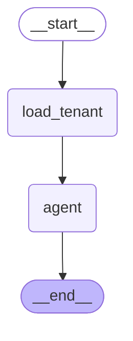
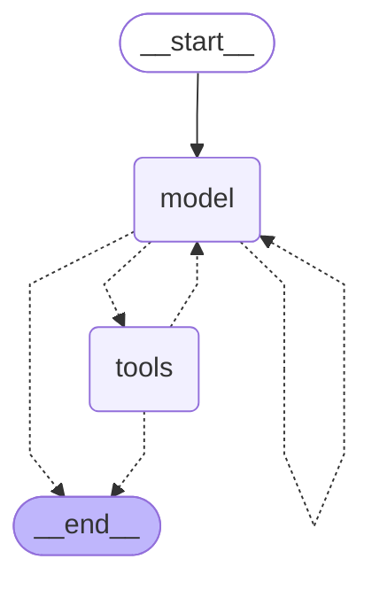

# Triage agent

Outer graph: load the tenant's context, then run the agent.

Inside the `agent` node: a `create_agent` loop over search_policies, check_open_tickets and create_ticket, ending in a TriageResult.

